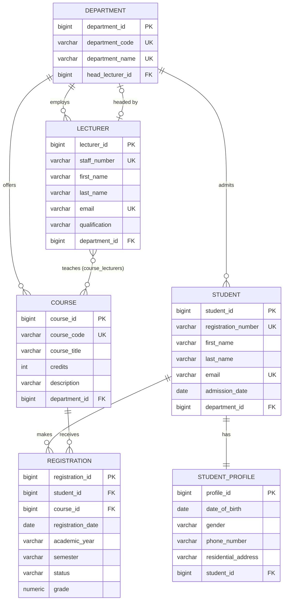
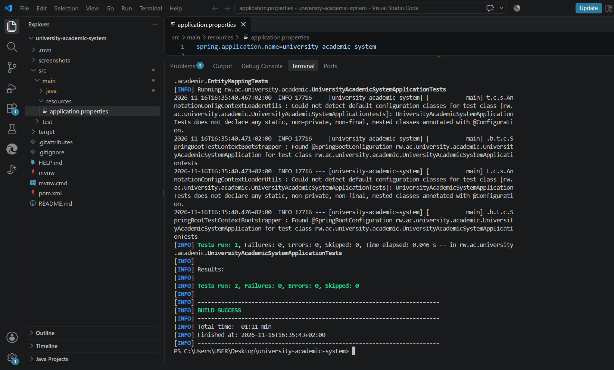
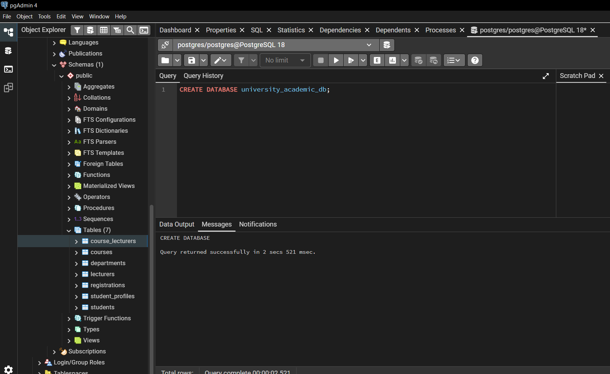
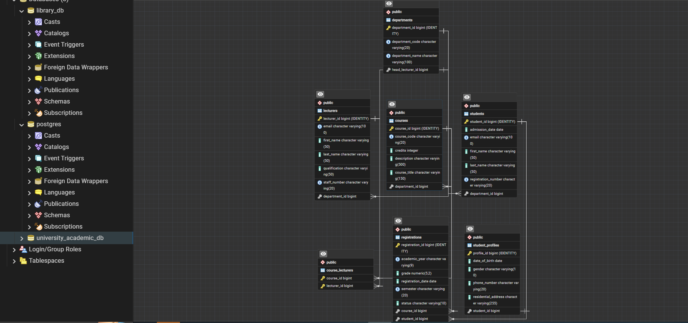
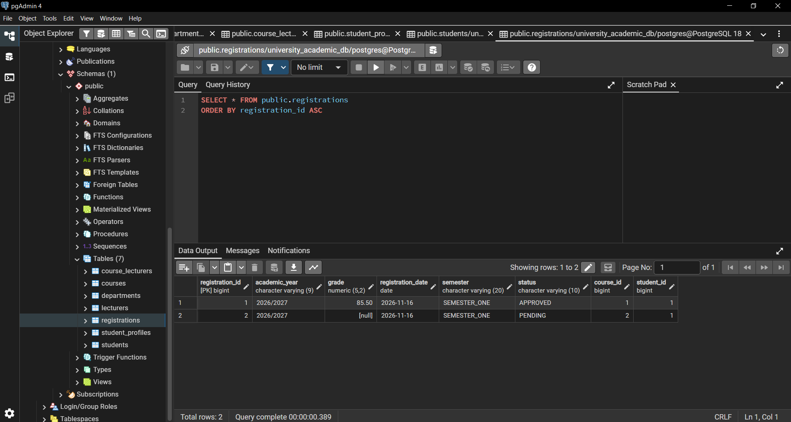
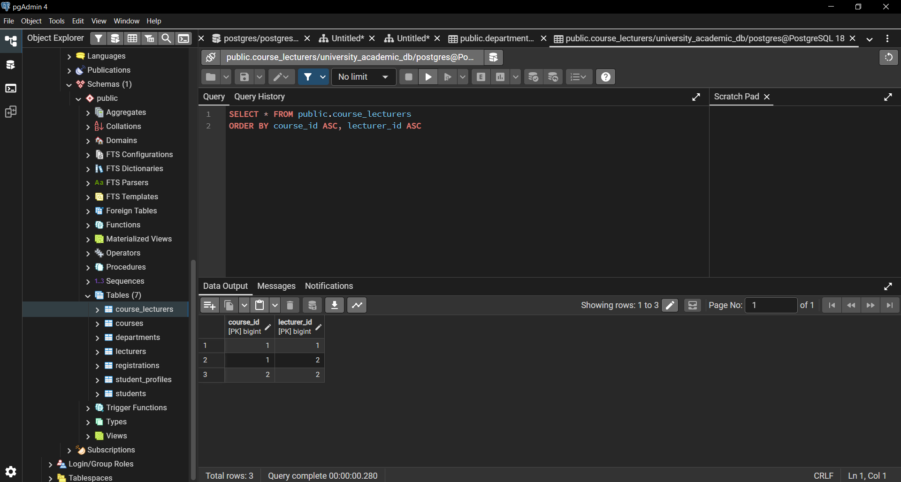
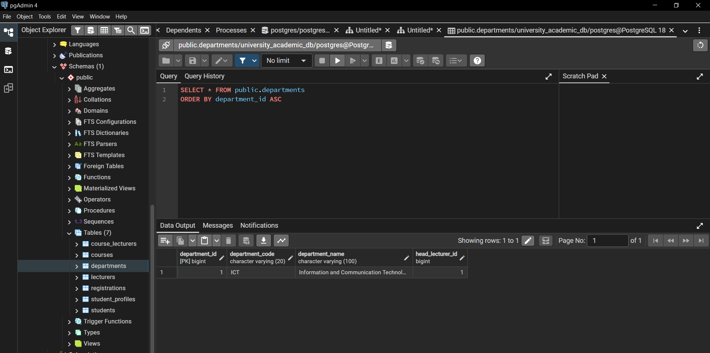
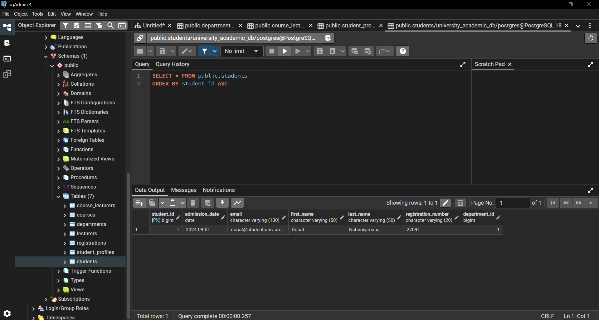
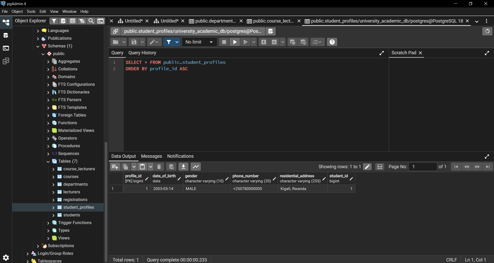

# University Course Registration and Academic Management System

**Course:** Web Technology and Internet — Individual Assignment
**Student:** NSHIMIYIMANA DONAT  **Registration No.:** 27091
**Stack:** Java 17+, Spring Boot, Spring Data JPA / Hibernate, PostgreSQL (`university_academic_db`), Maven
**Scope:** Model and Repository layers

---

## 1. Problem analysis

The university needs to manage departments, lecturers, students, their personal profiles, courses, which lecturers
teach which courses, and the students' course registrations. The nouns in the problem statement that carry their own
data and must be stored are the entities; the facts that link them are the relationships.

### 1.1 Entities and why they were chosen

| Entity | Why it is an entity |
|---|---|
| **Department** | The university "has several departments"; each one offers courses, employs lecturers, admits students and has a head. |
| **Lecturer** | Lecturers are employed by a department, teach courses and one of them heads the department. |
| **Student** | Students are admitted and assigned to a department, and register for courses. |
| **StudentProfile** | Each student has *exactly one* personal profile (date of birth, gender, phone, address) — a separate entity in a one-to-one relationship. |
| **Course** | Courses belong to a department, are taught by lecturers and registered for by students. |
| **Registration** | A student–course registration has its own data (date, academic year, semester, status, grade), so it must be a **join entity**. |

The lecturer–course assignment is **not** an entity: the statement says it must be kept *without a separate entity*,
and it carries no extra data, so a plain join table is enough.

### 1.2 Attributes

| Entity | Attributes (PK **bold**) |
|---|---|
| Department | **department_id**, department_code, department_name, head_lecturer_id (FK) |
| Lecturer | **lecturer_id**, staff_number, first_name, last_name, email, qualification, department_id (FK) |
| Student | **student_id**, registration_number, first_name, last_name, email, admission_date, department_id (FK) |
| StudentProfile | **profile_id**, date_of_birth, gender (MALE/FEMALE), phone_number, residential_address, student_id (FK, unique) |
| Course | **course_id**, course_code, course_title, credits, description, department_id (FK) |
| Registration | **registration_id**, student_id (FK), course_id (FK), registration_date, academic_year, semester, status (PENDING/APPROVED/REJECTED), grade |

### 1.3 Relationships and cardinality

| # | Relationship | Cardinality | How it is implemented |
|---|---|---|---|
| 1 | Department **offers** Course | 1 : N | Foreign key `courses.department_id` (`@ManyToOne` + `@JoinColumn`) |
| 2 | Department **employs** Lecturer | 1 : N | Foreign key `lecturers.department_id` |
| 3 | Lecturer **heads** Department | 1 : 1 | Foreign key `departments.head_lecturer_id` (UNIQUE) (`@OneToOne` + `@JoinColumn`) |
| 4 | Department **admits** Student | 1 : N | Foreign key `students.department_id` |
| 5 | Student **has** StudentProfile | 1 : 1 | Foreign key `student_profiles.student_id` (UNIQUE) |
| 6 | Lecturer **teaches** Course | M : N | **Join table** `course_lecturers` (`@ManyToMany` + `@JoinTable`) |
| 7 | Student **registers for** Course | M : N with attributes | **Join entity** `Registration` = two `@ManyToOne` links |

- **Foreign keys:** relationships 1, 2, 3, 4, 5 (and the two FKs inside Registration).
- **Join table:** relationship 6 (Lecturer–Course) — many-to-many with no extra data, no entity allowed.
- **Join entity:** relationship 7 (Student–Course) — many-to-many that must store registration date, academic year,
  semester, status and grade; a plain join table cannot hold these, so `Registration` is an entity.

---

## 2. Entity Relationship Diagram (ERD)



GitHub draws this diagram automatically from the code above.

---

## 3. Relational database schema

| Table | Primary key | Foreign keys | Other columns |
|---|---|---|---|
| `departments` | department_id | head_lecturer_id → lecturers(lecturer_id), UNIQUE | department_code UNIQUE, department_name UNIQUE |
| `lecturers` | lecturer_id | department_id → departments(department_id) | staff_number UNIQUE, first_name, last_name, email UNIQUE, qualification |
| `students` | student_id | department_id → departments(department_id) | registration_number UNIQUE, first_name, last_name, email UNIQUE, admission_date |
| `student_profiles` | profile_id | student_id → students(student_id), UNIQUE | date_of_birth, gender, phone_number, residential_address |
| `courses` | course_id | department_id → departments(department_id) | course_code UNIQUE, course_title, credits, description |
| `course_lecturers` (join table) | (course_id, lecturer_id) | course_id → courses, lecturer_id → lecturers | — |
| `registrations` (join entity) | registration_id | student_id → students, course_id → courses | registration_date, academic_year, semester, status, grade; UNIQUE(student_id, course_id, academic_year, semester) |

Short notation:

```
departments(department_id PK, department_code, department_name, head_lecturer_id FK→lecturers)
lecturers(lecturer_id PK, staff_number, first_name, last_name, email, qualification, department_id FK→departments)
students(student_id PK, registration_number, first_name, last_name, email, admission_date, department_id FK→departments)
student_profiles(profile_id PK, date_of_birth, gender, phone_number, residential_address, student_id FK→students UNIQUE)
courses(course_id PK, course_code, course_title, credits, description, department_id FK→departments)
course_lecturers(course_id FK→courses, lecturer_id FK→lecturers, PK(course_id, lecturer_id))
registrations(registration_id PK, student_id FK→students, course_id FK→courses, registration_date,
              academic_year, semester, status, grade)
```

---

## 4. Project structure

```
src/main/java/rw/ac/university/academic/
├── UniversityAcademicSystemApplication.java
├── model/
│   ├── Department.java        Lecturer.java       Course.java
│   ├── Student.java           StudentProfile.java Registration.java
│   └── Gender.java            Semester.java       RegistrationStatus.java   (enums)
└── repository/
    ├── DepartmentRepository.java   LecturerRepository.java   CourseRepository.java
    └── StudentRepository.java      StudentProfileRepository.java   RegistrationRepository.java
src/main/resources/application.properties   (PostgreSQL + Hibernate configuration)
src/test/java/.../EntityMappingTests.java   (saves sample data through every relationship)
```

Hibernate annotations used: `@Entity`, `@Table`, `@Id`, `@GeneratedValue`, `@Column`, `@Enumerated`,
`@OneToOne`, `@OneToMany`, `@ManyToOne`, `@ManyToMany`, `@JoinColumn`, `@JoinTable`, `@UniqueConstraint`.

---

## 5. How to run

1. Create the database in PostgreSQL: `CREATE DATABASE university_academic_db;`
2. Put your PostgreSQL password in `src/main/resources/application.properties` (`spring.datasource.password`).
3. Run the tests (creates the tables and inserts sample data): `mvnw.cmd test` (Windows) or `./mvnw test`.
4. Open pgAdmin → `university_academic_db` → Schemas → public → Tables to see the 7 generated tables.

---

## 6. Screenshots

Screenshots of the generated tables and relationships are in [`screenshots/`](screenshots/).

**Build and mapping tests passed**


**The 7 generated tables in `university_academic_db`**


**ERD generated by pgAdmin from the database (foreign keys and relationships)**


**`registrations` — join entity Student ↔ Course with date, year, semester, status, grade**


**`course_lecturers` — join table Lecturer ↔ Course (many-to-many)**


**`departments` — with `head_lecturer_id` (one-to-one head of department)**


**`students` — each student assigned to a department**


**`student_profiles` — one-to-one with `students` through `student_id`**

